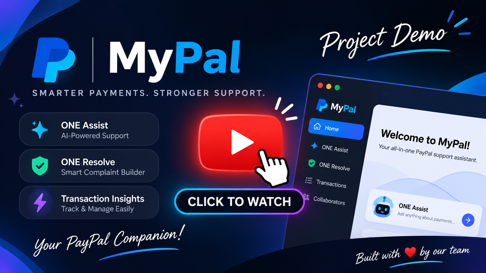
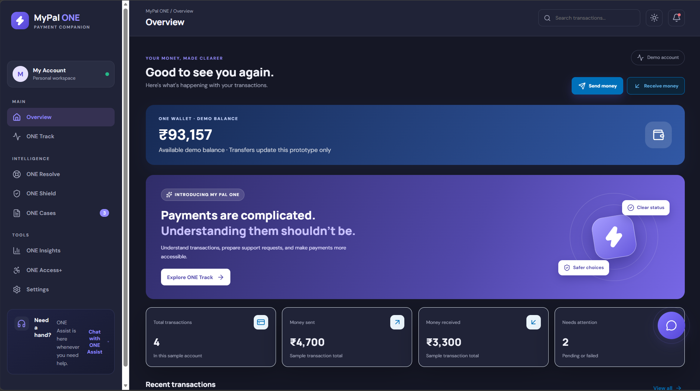
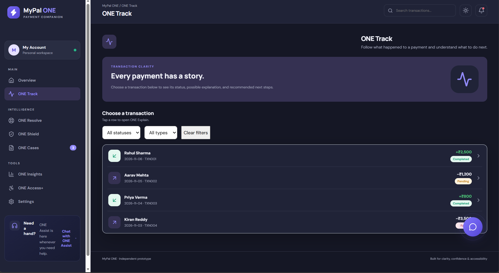
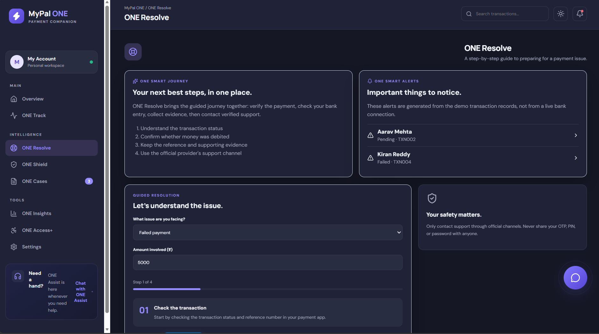
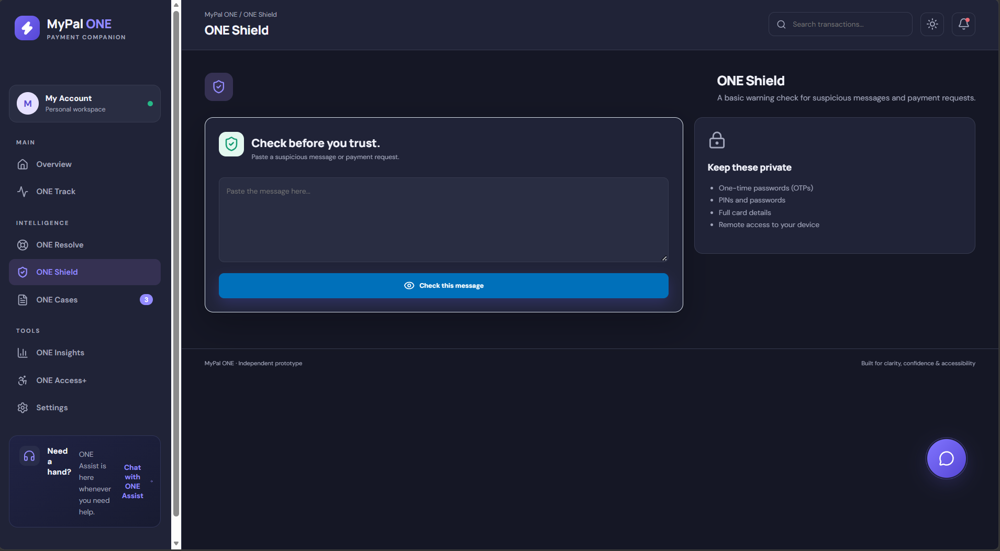
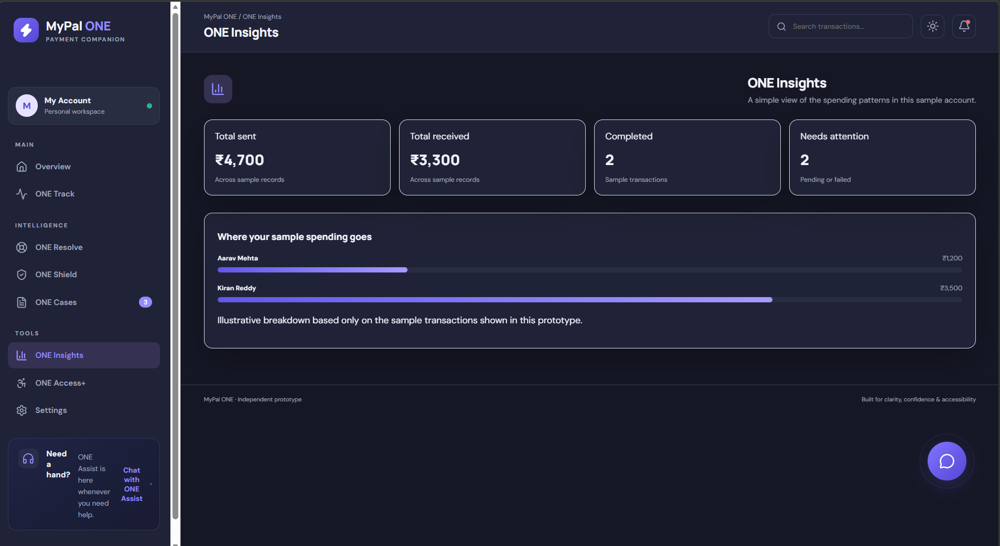
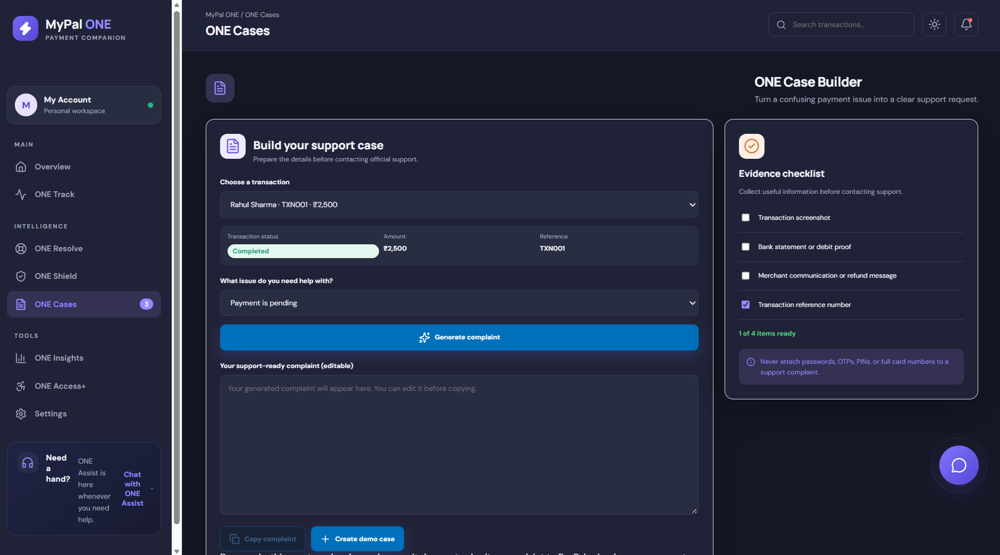
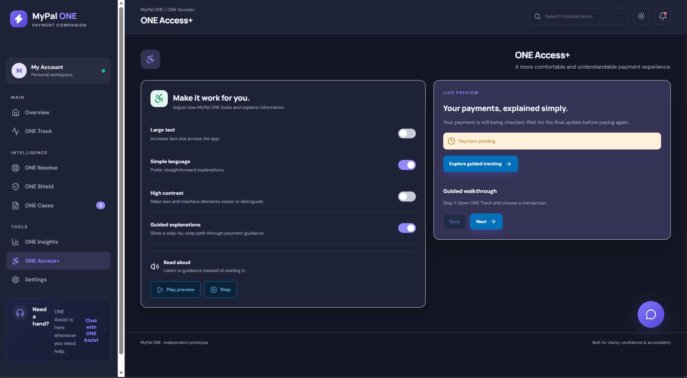

<!-- Please replace anything appearing between curly brackets with your submission's value.  -->

# MyPal ONE 

 MyPal ONE is an intelligent payment companion that simplifies digital payments through smart tracking, guided issue resolution, fraud awareness, and personalized financial insights — all in one place. 🚀. 

## Details

## 💡 Project Highlights & Innovation

### 🎯 What Problem Does MyPal ONE Solve?
Digital payments are convenient, but failed transactions, confusing payment statuses, suspicious requests and complicated complaint processes can leave users helpless. **MyPal ONE bridges this gap** by bringing payment tracking, intelligent assistance, fraud awareness and guided issue resolution into one unified platform.

### ⚡ What Makes Our Project Interesting?
- **ONE Resolve:** Combines guided Smart Journey and Smart Alerts to help users understand what to do next.
- **ONE Assist:** Provides conversational, transaction-aware assistance.
- **ONE Shield:** Helps users identify potentially suspicious payment messages and requests.
- **ONE Global:** Introduces multi-currency selection and exchange-rate conversion.
- **ONE Access+:** Makes payment guidance more accessible.
- **ONE Wallet:** Demonstrates integrated send and receive money experiences.

### 🛠️ Interesting Libraries & Services
- **React + TypeScript:** Interactive and structured frontend development.
- **Vite:** Fast development and build tooling.
- **Lucide React:** Clean, consistent interface icons.
- **Python + FastAPI:** Backend APIs and assistant functionality.
- **Exchange Rate API:** Currency conversion estimates for ONE Global.

### 🚀 What Did We Build?
A unified fintech web application featuring multiple connected modules:
- Payment tracking and issue resolution.
- AI-style conversational assistance.
- Payment safety and awareness tools.
- Support case management and financial insights.
- Accessibility-focused features.
- Simulated wallet transfers and global currency conversion.
- 
---

**Our Vision:** Make every digital payment easier to understand, safer to manage and simpler to resolve.

## 🎥 Watch MyPal in Action

  

  Click the thumbnail above to watch our complete project demonstration.

## Application Screenshots

### Dashboard

### ONE Track

### ONE Resolve

### ONE Shield

### ONE Insights

### ONE Cases

### ONE Access+

## 👨‍💻 Collaborators

| Team Member | | GitHub Profile |
|---|---|---|
| Shivam | |  |
| Sahithi | |  |
